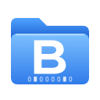
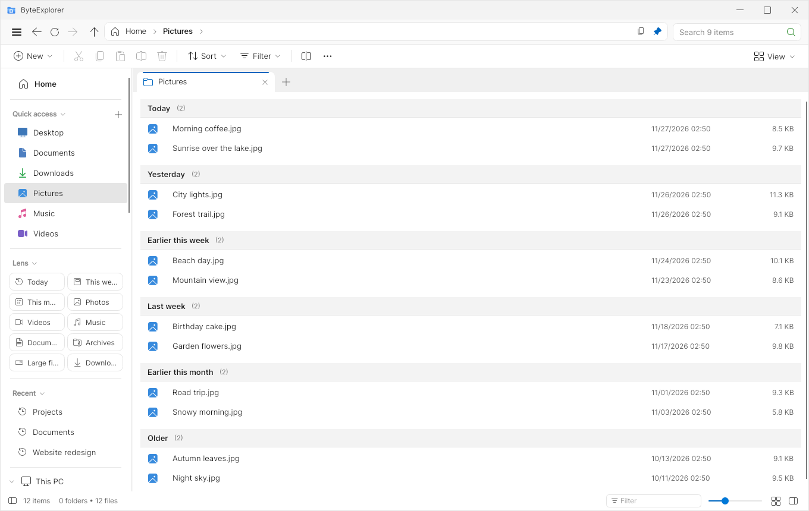
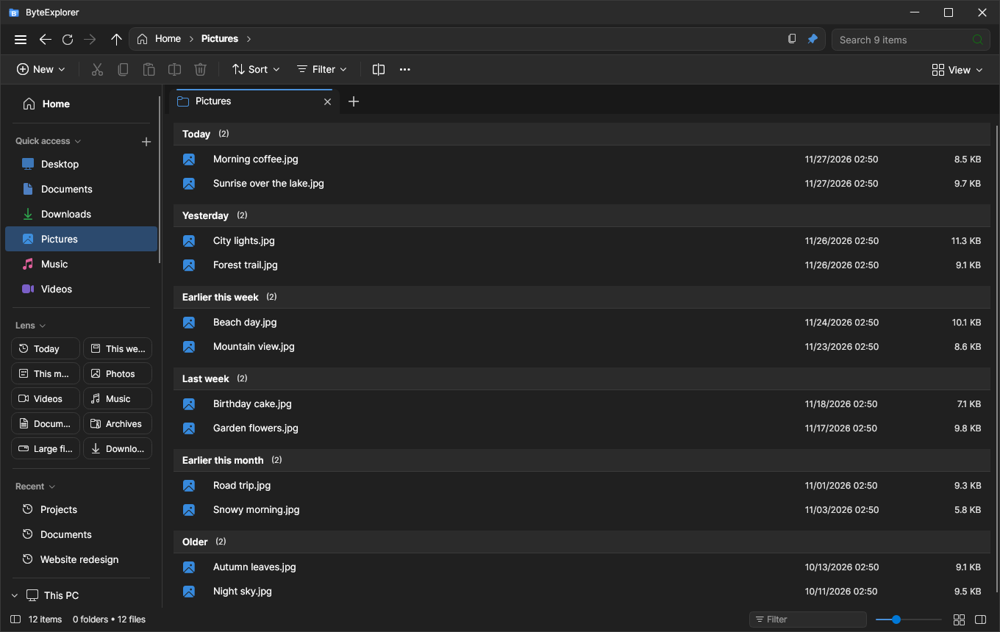
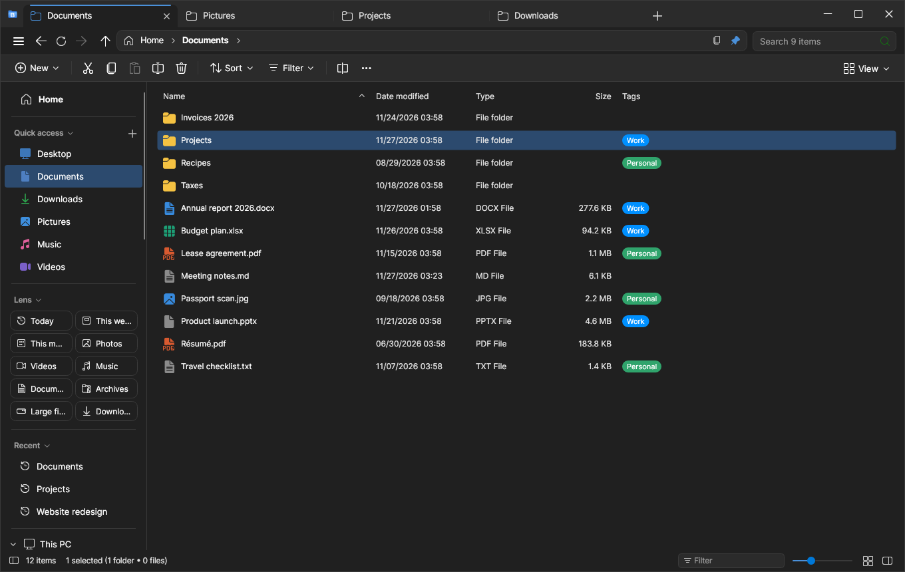
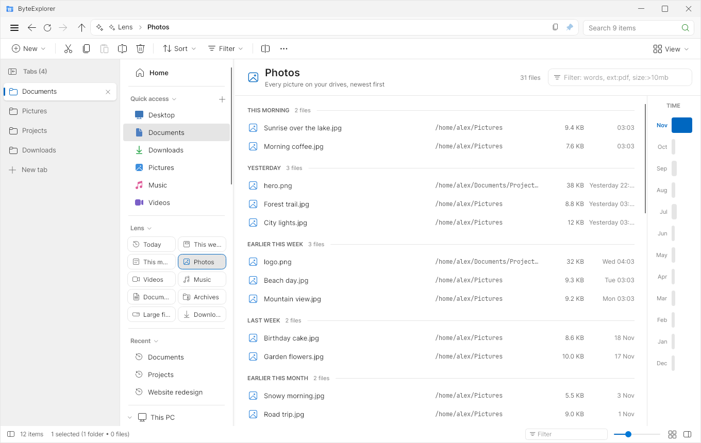
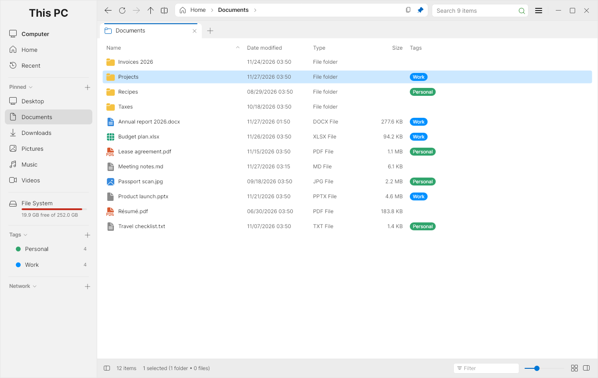
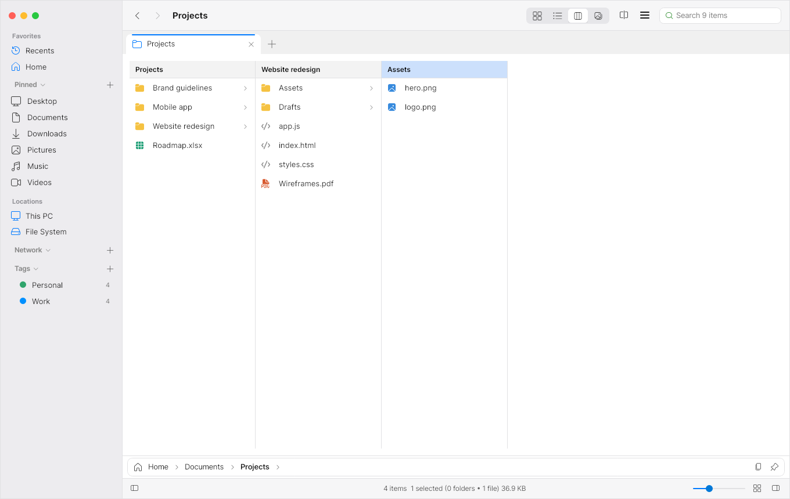
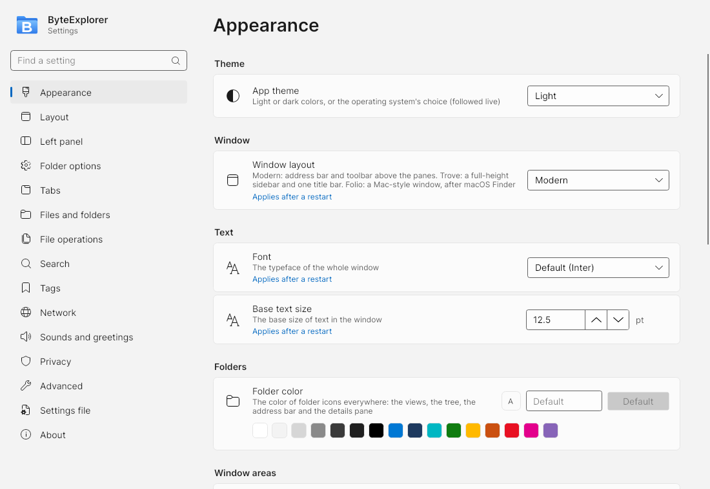

<div align="center">



# ByteExplorer

**A fast, beautiful file explorer for Windows, Linux and macOS.**

Tabs, split view, instant search, tags, smart views, and safe file operations you can undo,<br/>
in a window you can make your own.

[](LICENSE)


-0067C0.svg)




</div>

## Why ByteExplorer?

- **Fast with huge folders.** Folders with hundreds of thousands of items open and scroll smoothly; only what is on screen is built.
- **Finds things instantly.** A search index across your drives answers as you type, with filters (`kind:image`, `size:>1gb`, `modified:week`), and can also look **inside files**: text, Word, Excel, PowerPoint, OpenDocument and PDF.
- **Safe with your files.** Copies are verified and never left half-written, a crash is recovered on the next start, and nearly everything can be undone with **Ctrl+Z** and redone with **Ctrl+Y**.
- **Yours to shape.** Three window layouts, five left-panel designs, light and dark themes, colors, fonts and backgrounds for each part of the window.
- **Private by design.** No telemetry, no accounts, no automatic updates. ByteExplorer never connects to the internet on its own.

## Features

### Browse
- **Tabs** (in the title bar, on top, or as a vertical list) and **split view** with two panes side by side
- **New windows** (Ctrl+N) that share one search index, one undo history and one copy queue
- **Views:** Details, List, Tiles, Icons in four sizes, Columns, Timeline and Nexus
- **Details columns** you choose: date created, dimensions, length, artists, owner, attributes and more
- **Preview pane** for pictures, video, music, text, and Office and PDF documents
- **Archives as folders:** ZIP, 7z, RAR, TAR, ISO and more, with "Extract all" and "Extract here"
- **Phones and cameras** over USB, in This PC and the folder tree
- A real **Recycle Bin / Trash view**: see where items came from, restore them, empty it

### Organize
- **Tags** in colors, with sub-tags and comments, shown in every view and searchable with `tag:`
- **Lens:** smart views over all your drives (Today, This week, Photos, Videos, Music, Documents, Large files, Downloads) with a **time river** to jump through months
- **Bulk rename** with a live preview: find and replace (regex too), numbering, case, extensions, dates
- **Password protection:** lock any file or folder into an encrypted `.bxlock` item that opens only with your password
- **Folder sizes**, counted in the background, shown and sortable like any column
- **Quick access** pins with names and colors, and recent folders

### Copy and move with confidence
- A **file operation queue** with progress, speed, time left, pause and cancel
- **Name clashes** handled your way: replace, skip, keep both, or replace only if newer, for one item or all
- **Undo and redo** for copy, move, rename, delete, restore and bulk rename
- **Verified copies**, free-space checks before starting, and recovery after a crash or power loss

### Make it yours
- **Layouts:** Modern (as Windows 11), Trove (full-height sidebar) and Folio (Mac style)
- **Left panel designs:** Classic, Quiet labels, Soft cards, Icon headers with guides, Folded chips
- **Right-click menu:** ByteExplorer's own, the Windows menu with every program's entries, or both with "Show more options"
- **Default file explorer:** optionally open folders, drives and Win+E in ByteExplorer, and give them back with one switch
- A **Settings** window with every option, searchable, applied at once

## Screenshots

| | |
|---|---|
| <br/><sub>**Modern**, dark theme, Timeline view</sub> | <br/><sub>**Modern**, Details view, tabs in the title bar</sub> |
| <br/><sub>The **Photos lens** with its time river, tabs on the left</sub> | <br/><sub>**Trove** layout, Details view with tags</sub> |
| <br/><sub>**Folio** layout, Columns view</sub> | <br/><sub>**Settings**</sub> |

## Download

Ready-to-run builds are on the **[Releases page](https://github.com/Eliquin/ByteExplorer-public/releases/latest)**.
Nothing else to install: .NET is included.

| System | Download | How to start |
|---|---|---|
| **Windows 10/11 (64-bit)** | `ByteExplorer-<version>-win-x64.zip` | Unzip it anywhere (e.g. `Documents\ByteExplorer`) and run `ByteExplorer.exe`. VLC for video and music previews is included. |
| **Linux (64-bit)** | `ByteExplorer-<version>-linux-x64.tar.gz` | `tar -xzf ByteExplorer-*-linux-x64.tar.gz`, then run `./ByteExplorer` in the extracted folder. Install VLC for video and music previews (see below). |

- **Windows SmartScreen:** the program isn't code-signed yet, so the first start may show "Windows protected your PC".
  Click **More info**, then **Run anyway**.
- `SHA256SUMS.txt` on each release lets you check the downloads (`sha256sum -c SHA256SUMS.txt`, or
  `Get-FileHash` in PowerShell).
- A macOS build isn't published yet; on a Mac, build it from source as below (macOS is experimental, see below).
- `vlc-<version>.tar.xz` on a release is VLC's source code, published because the Windows build includes VLC
  (its license asks for that). You don't need it to use ByteExplorer.

### Tested platforms

- **Windows (64-bit): tested and working.** ByteExplorer is built and used by its author on Windows 10; Windows 11 is
  supported too.
- **Linux (64-bit): tested and working.** The full automated test suite (600+ tests) runs on Linux, and the release
  build was started and checked on Ubuntu 24.04. Reports from different distributions and desktops (GNOME, KDE,
  Xfce, …) are welcome.
- **macOS: experimental and untested.** The code supports macOS (Trash, volumes, VLC.app), but it hasn't been run on a
  Mac yet and no macOS build is published. Expect rough edges; [bug reports](https://github.com/Eliquin/ByteExplorer-public/issues)
  are very welcome.

## Build from source

Building needs the [.NET 9 SDK](https://dotnet.microsoft.com/download/dotnet/9.0) (or a newer one). To build and run it:

```bash
git clone https://github.com/Eliquin/ByteExplorer-public.git
cd ByteExplorer-public
dotnet run --project ByteExplorer.csproj -c Release
```

- **Windows:** everything is included, VLC's libraries for video and music previews too. A Windows installer can be
  built with `Tools/Installer/build-installer.ps1` (Inno Setup 6); it installs per user or for everyone and has no updater.
- **Linux:** install VLC for video and music previews (see below); `bsdtar` or `7z` for 7z/RAR archives; `pdftoppm`
  (poppler-utils) for PDF previews. Everything else works without them.
- **macOS:** install VLC for video and music previews (see below).

### Video and music previews (VLC)

ByteExplorer plays video and music in its preview pane with VLC's engine (libvlc 3). On **Windows** it comes with the
app and there is nothing to do. On **Linux and macOS** ByteExplorer uses the VLC installed on the computer:

| System | Install | Notes |
|---|---|---|
| Ubuntu, Debian, Mint | `sudo apt install vlc` | Install the full `vlc` package: `libvlc5` alone leaves out the codec and output plugins, and nothing plays. |
| Fedora | `sudo dnf install vlc` from [RPM Fusion](https://rpmfusion.org/Configuration) | Fedora's own build can't play some common formats (H.264, HEVC); RPM Fusion's plays them. |
| Arch, Manjaro | `sudo pacman -S vlc` | |
| openSUSE | `sudo zypper install vlc` (Packman's build for all formats) | |
| macOS | Download VLC from [videolan.org](https://www.videolan.org/vlc/), or `brew install --cask vlc` | VLC must be in **`/Applications`** (`/Applications/VLC.app`), where ByteExplorer looks for it. |

- **Not the Flatpak or Snap.** VLC installed from Flathub or the Snap Store stays inside its own sandbox, where other
  apps can't use it. Install your distribution's package as shown above (it can sit next to the Flatpak or Snap).
- Restart ByteExplorer after installing VLC.
- Without VLC, ByteExplorer works normally: only video and music previews are unavailable (and their length and
  artist details), and a line in the log says libvlc could not be loaded.

New versions are published on the [Releases page](https://github.com/Eliquin/ByteExplorer-public/releases). ByteExplorer
never updates itself: you update by downloading a new release.

## Under the hood

ByteExplorer is written in **C#** on **.NET 9** with the **[Avalonia](https://avaloniaui.net/)** UI framework, with
native code paths for each system (the Windows shell, the Linux desktop's Trash and MIME handlers, macOS volumes).
More than 600 automated tests cover the views, search, file operations and settings.

The details of every feature, how it works and how the code is organized are in
**[docs/TECHNICAL-NOTES.md](docs/TECHNICAL-NOTES.md)**.

## Contributing

Bug reports, ideas and pull requests are welcome. See [CONTRIBUTING.md](CONTRIBUTING.md) for how to build, test and
send a change.

## License

ByteExplorer is free and open-source software under the **[Mozilla Public License 2.0](LICENSE)**.
Copyright © 2026 Eliquin and ByteExplorer contributors.

It is built with Avalonia, SkiaSharp, LibVLC, Serilog, the Inter typeface and the Fluent UI System Icons; their
licenses are listed in [THIRD-PARTY-NOTICES.md](THIRD-PARTY-NOTICES.md).

---

<div align="center">
<sub>Coded with love, in C#. ❤️</sub>
</div>
